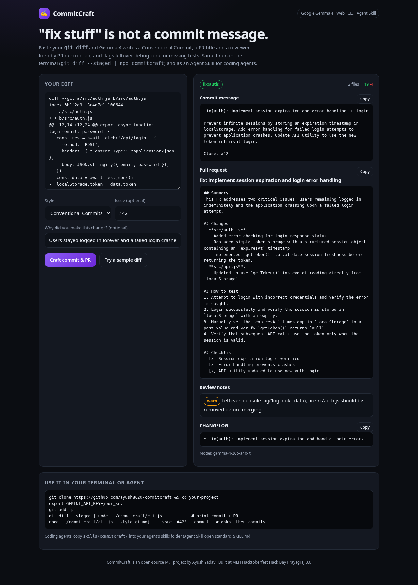

# ✍️ CommitCraft

**Git diff in, perfect commit message and PR description out.** CommitCraft uses **Google Gemma 4** (an open-weight model) to turn your changes into a Conventional Commit, a PR title, a reviewer-friendly PR description and a CHANGELOG line. It also reviews the diff for leftover debug code, missing tests and possible secrets.

It comes in three forms that share one core (`lib/craft.js`):
1. 🌐 **Web app**: paste a diff in the browser.
2. 💻 **Zero-dependency CLI**: `git diff --staged | node cli.js`.
3. 🤖 **Agent Skill**: `skills/commitcraft/SKILL.md` follows the [Agent Skill open standard](https://agentskills.io), so coding agents can write commits and PRs for you.



## Why
During Hacktoberfest, maintainers get floods of PRs titled "Update file" with empty descriptions, and first-time contributors don't know what a good PR looks like. CommitCraft teaches by example: every commit and PR it writes follows best practice, and it catches the `console.log` you forgot.

## Prize track
**Best Open-Source AI Project** (Hacktoberfest 2026 × MLH). It's an original open-source MIT project where open-weight AI (Gemma 4) is the core. It ships an **Agent Skill** that complies with the Agent Skill Open Standard. It also fits **Best Use of Gemma 4**.

## Features
- Conventional Commits, Gitmoji or simple styles; link an issue (`Closes #42`) and add a "why" note.
- PR description with Summary, Changes, How to test and Checklist sections.
- Review notes with severity info / warn / risk, and a suggestion for splitting a diff that mixes unrelated changes.
- Skips lockfiles, minified files, source maps and binaries, and caps large diffs to fit the free tier.
- `--commit` asks for confirmation and then commits with the generated message. It never pushes.

## CLI
```bash
git clone https://github.com/ayush8620/commitcraft
export GEMINI_API_KEY=your_key            # free: https://aistudio.google.com/apikey
cd your-project && git add -p
git diff --staged | node ../commitcraft/cli.js
node ../commitcraft/cli.js --style gitmoji --issue "#42" --note "users were logged out on refresh"
node ../commitcraft/cli.js --json          # machine-readable output (used by the Agent Skill)
node ../commitcraft/cli.js --commit        # asks, then runs git commit -F -
```

## Agent Skill
Copy `skills/commitcraft/` into your agent's skills directory (for example `~/.claude/skills/` or `.github/skills/`). The agent reads `SKILL.md`, stages changes, runs the CLI with `--json`, shows you the message and only commits after you confirm.

## Web app (run locally)
```bash
cp .env.example .env && export GEMINI_API_KEY=your_key
node server.js      # http://localhost:3000, Node 18+, no npm install
```

## Deploy (free)
Import the repo on [Vercel](https://vercel.com/new) (preset "Other"), set `GEMINI_API_KEY`, and deploy. The `api/craft.js` serverless function powers the web app.

## Tech
- Vanilla JS frontend, Node 18+ serverless function and CLI, with **zero npm dependencies**.
- **Google Gemma 4** (`gemma-4-31b-it` and `gemma-4-26b-a4b-it` in parallel with retries) via the Gemini API.

| Path | What |
|---|---|
| `lib/craft.js` | core: diff trimming, stats, prompt, Gemma call |
| `cli.js` | terminal tool (`commitcraft` bin) |
| `skills/commitcraft/SKILL.md` | Agent Skill |
| `api/craft.js`, `api/_gemma.js` | web API + Gemma 4 client |
| `index.html`, `style.css`, `app.js` | web UI |
| `server.js` | local dev server |

## License
[MIT](LICENSE) © 2026 Ayush Yadav. Built at MLH Hacktoberfest Hack Day Prayagraj × WikiClub Tech UIT (Edition 3.0).
